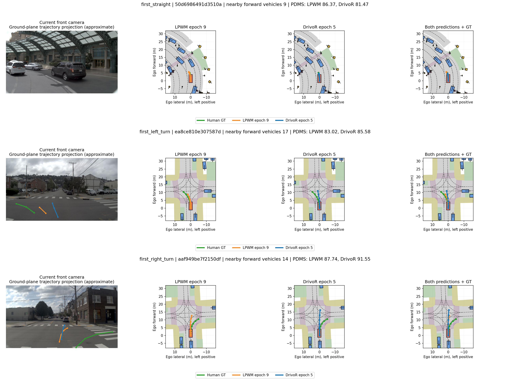
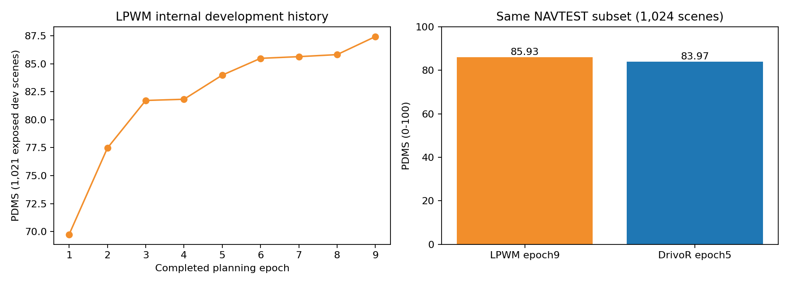
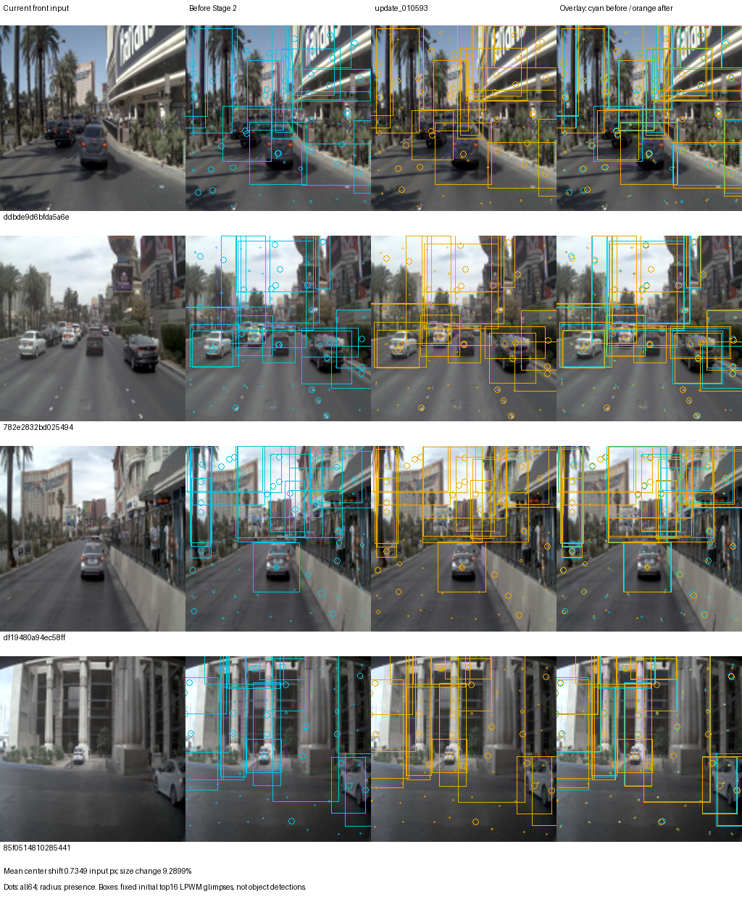

# LPWM and DrivoR: native NAVSIM planning visualization

Same fixed NAVTEST subset, 1,024 scenes. Latest fixed LPWM checkpoint is planning epoch9; DrivoR is preserved final epoch5.

| Model | Epoch | PDMS | ADE m | FDE m |
|---|---:|---:|---:|---:|
| lpwm | 9 | 85.9317 | 1.4212 | 3.5233 |
| drivor | 5 | 83.9662 | 1.8092 | 4.3526 |

| Actual driving command | Scenes | LPWM PDMS | DrivoR PDMS |
|---|---:|---:|---:|
| straight | 741 | 87.9285 | 86.0802 |
| left_turn | 193 | 81.7080 | 80.1026 |
| right_turn | 90 | 78.5485 | 74.8466 |

| Official mean submetric (0-1) | LPWM | DrivoR |
|---|---:|---:|
| no_at_fault_collisions | 0.977539 | 0.987793 |
| drivable_area_compliance | 0.957031 | 0.940430 |
| ego_progress | 0.792244 | 0.761232 |
| time_to_collision_within_bound | 0.932617 | 0.943359 |
| comfort | 1.000000 | 1.000000 |
| driving_direction_compliance | 0.956055 | 0.968750 |

Latest completed LPWM epoch9 versus preserved DrivoR epoch5 on identical NAVTEST1024 scenes. Training amount, data, history, resolution, SSL and seed differ. This is a systems diagnostic, not a matched-budget comparison or original DrivoR paper reproduction.

LPWM planning: 75,297 scenes x9 passes, 10,593 updates, effective batch64, seed2; front1/history4/128x128; reused Stage1 23,126 clips x20 epochs. DrivoR adaptation: 10,240 scenes x5 passes, 3,200 updates, effective batch16, seed47; front1/history2/512x256, public DINOv2 plus official q/v LoRA and common planner. These are different training budgets.
LPWM GPU inference: 301.82s, peak reserved 1.873GB, largest sampled whole-card use 43.297GB <48GB. Official PDMS failures: 0/1024. Existing DrivoR predictions/scores reused byte-for-byte.
Original training continues without changes to batch, optimizer, learning rate, checkpoint or queue. Current ongoing epoch is separate from the fixed epoch9 checkpoint shown here.

Comparison colors: green human GT, orange LPWM epoch9, blue DrivoR epoch5. Dots are 0.5s waypoint intervals over a 4s horizon. Camera projection assumes a flat ego ground plane; BEV positions use the saved ego-frame trajectory directly.
Map and current GT object boxes come from native NAVSIM plotting. Box colors denote object types. Each network uses front camera only; GT map/boxes are visualization context, not model input.
High-level native plot_bev_with_agent was also executed for both models and all six scenes. In those individual native PNGs the original library colors apply.







Particle panel uses separate fixed internal development scenes. Cyan is after Stage1/before Stage2; orange is the snapshot identified in particle_diagnostics.json. Dot center/size represent particle geometry/presence; rectangles are LPWM glimpses rather than detected objects.

## Detailed scenes

[first_straight](first_straight_navsim.png) — 50d6986491d3510a
[vehicle_rich_straight](vehicle_rich_straight_navsim.png) — 74d0c56b12f25f92
[first_left_turn](first_left_turn_navsim.png) — ea8ce810e307587d
[vehicle_rich_left_turn](vehicle_rich_left_turn_navsim.png) — 5c4c3448f7a1517f
[first_right_turn](first_right_turn_navsim.png) — aaf949be7f2150df
[vehicle_rich_right_turn](vehicle_rich_right_turn_navsim.png) — b0a6370d836a59ed

## Replay

```bash
cd /rhome/junseong/PlanningAwareFuturePrediction
runtime/environments/kjs-lpwm-drivor-joint/bin/python scripts/run_lpwm_drivor_navsim_visualization.py --config configs/lpwm_front_history_stage1_lora/epoch9_navsim_visualization.json
```
