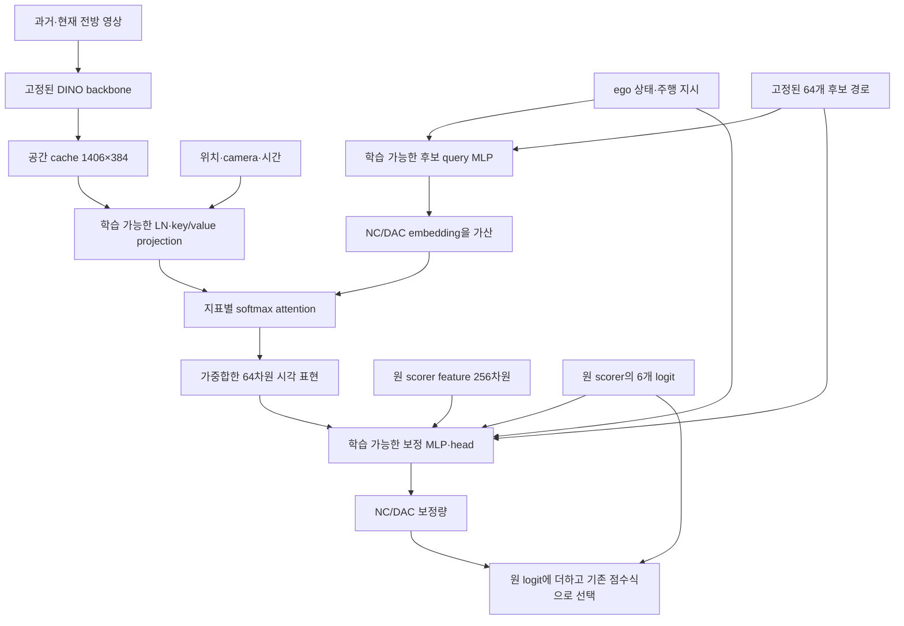

# NC·DAC 시각 reader: 학습 경로와 구조 진단

## 결론

**Attention에 gradient는 전달되지만, 목적별 공간 정보를 읽도록 충분히 요구하는 구조는 아니다.** 기존 scorer 표현을 직접 사용하는 경로와, 후보 경로·지표의 상호작용을 제한하는 가산 query를 확인했다. 하늘처럼 보이는 영역에 강조가 생긴 원인을 하나로 확정한 것은 아니다.

이 진단의 대상은 **고정된 DINO/DrivoR cache에 붙인 NC·DAC reader**다. 진행 중인 LPWM Stage2와는 별도 실험이다.

## 실행 범위

- 조사일: 2026-10-11. 기존에 고정한 개발셋 12장면, 저장된 Specific 100/500-step checkpoint를 사용했다.
- CPU만 사용했다. 추가 optimizer step 0, encoder 호출 0, GPU 시간 0. 진단 loop 약 1.12초.
- 원 pilot의 source/input registration을 검증했고, LPWM 보호 대상 289개 파일에 변경이 없었다.
- 하늘·도로의 semantic mask는 없다. 이미지 상하단은 좌표 기준 진단이며 하늘·도로 대응 정확도로 보고하지 않는다.
- 입력을 0으로 대체하는 것은 분포 밖의 기능 진단이다. 새 모델을 학습한 어블레이션이나 인과적 기여도 측정은 아니다.

## 현재 구조



실제 계산은 다음과 같다. 현재 구현은 위치를 key와 value 모두에 추가한다.

```text
key_i   = Linear_key(LN(feature_i)) + Linear_position(position_i)
value_i = Linear_value(LN(feature_i)) + Linear_position(position_i)
query_candidate,metric = MLP(ego, candidate_path) + embedding_metric
attention_candidate,metric,i = softmax_i(query · key_i / sqrt(64))
readout_candidate,metric = sum_i(attention_i * value_i)
corrected_logit_metric = original_logit_metric + 3*tanh(head(...))
```

장면당 과거·현재 각 703개, 총 1,406개 token이다. 각 token은 384차원, key/value/query는 64차원이다. 후보 64개는 각각 8개 waypoint의 x·y·heading을 가진다. Ego 상태·주행 지시는 11차원 입력이다.

Softmax는 과거·현재 token 전체에서 계산한다. 시각화는 현재 703개 token의 가중치를 원본 영상 위치로 되돌린 것이다. 현재 프레임만 따로 정규화하지 않는다. 표시하는 농도는 1,406×attention이며, 전체를 균등하게 읽으면 1이다.

## Loss와 gradient 흐름

```text
L = BCE(보정한 NC/DAC logit, 후보별 공식 NC/DAC 정답)
  + 공식 PDMS 차이로 가중한 후보 간 ranking loss
```

정답은 각 후보 경로를 기존 공식 evaluator로 평가한 점수다. 차량 box나 차선 pixel 정답은 사용하지 않았다. NC의 0.5 soft target도 보존한다. Ranking loss는 같은 장면에서 공식 PDMS가 높은 후보를 예측 점수에서도 더 높게 채점하도록 한다. 공식 evaluator와 argmax 자체를 미분하지 않는다.

```text
loss
 → 보정한 NC/DAC logit
 → 보정 head·MLP
 → 시각 readout
 → attention 및 value projection
 → 후보 query·metric embedding·key projection·LN·position projection
```

원본 feature cache와 DINO, 원 planner/scorer 가중치는 업데이트하지 않는다. 고정된 feature를 읽는 새 key/value/query 변환을 학습한다. 동시에 원 scorer feature·ego·경로·logit을 보정 MLP에 직접 넣는 경로에서도 loss를 줄일 수 있다.

읽은 표현을 z, token i의 attention logit을 s_i라 하면 다음 관계를 가진다.

```text
∂L/∂s_i = attention_i * (∂L/∂z) · (value_i - z)
```

현재 head가 해당 token의 value를 더 읽어서 loss를 줄일 수 있을 때 가중치가 커지는 방향으로 업데이트된다. 이 과정에 차량/보행자/차선 위치 정답은 없으므로 색이 진해지는 것과 특정 객체에 대한 학습은 같은 의미가 아니다. Value 변환을 바꿔 loss를 줄이고 attention 분포는 거의 바꾸지 않는 것도 가능하다.

## 확인한 구조적 문제

### 1. 단순 가산 query는 후보·지표의 상호작용을 제한한다

같은 장면의 token i,j에 대해 NC와 DAC의 상대적 읽기 비율을 비교하면 후보 query가 식에서 소거된다.

```text
log(A_NC,c,i / A_NC,c,j) - log(A_DAC,c,i / A_DAC,c,j)
 = (embedding_NC - embedding_DAC) · (key_i - key_j) / sqrt(64)
```

따라서 **같은 장면에서 NC와 DAC가 token 쌍을 서로 다르게 강조하는 정도**는 후보 경로 및 ego query와 무관하다. Absolute attention은 후보마다 달라질 수 있으며, 두 지표의 map이 항상 같다는 뜻은 아니다.

실제 모델의 후보 간 차이는 100 step에서 최대 2.38e-6, 500 step에서 3.81e-6으로 부동소수점 오차 수준이었다. 후보마다 다른 NC/DAC evidence를 읽으려는 목적에 제약이 된다.

합성 검사에서는 `MLP(concat(candidate_condition, metric_embedding))`으로 비선형 결합하면 이 제약이 없어지는 것을 확인했다. 이는 표현 가능한 구조의 확인이며 학습 성공이나 planning 개선을 측정한 결과가 아니다. 실제 모델을 교체하거나 추가 학습하지 않았다.

### 2. 공간 readout을 우회하는 직접 경로도 실제로 쓰인다

12장면에서 특정 보정 head 입력만 0으로 바꿨을 때 NC/DAC logit의 평균 절댓값 변화:

| checkpoint | 시각 readout을 0으로 | 원 scorer feature를 0으로 |
|---|---:|---:|
| 100 step | 0.06255 | 0.21988 |
| 500 step | 0.21862 | 0.48575 |

500-step 모델의 선택이 바뀐 장면 수는 시각 readout 제거 1/12, 원 scorer feature 제거 4/12였다. 직접 경로가 사용되는 것은 확인했지만 입력 차원·분포·0 대체 효과가 다르므로 이 값의 비율을 중요도나 인과적 기여율로 해석하지 않는다.

원 scorer feature에도 이미지 정보는 있다. 우회 경로란 이미지를 전혀 쓰지 않는다는 뜻이 아니라, **이번에 시각화한 공간 attention을 사용하지 않고도** 예측할 수 있는 경로라는 의미다.

### 3. 지표 점수 정답만으로는 서로 다른 영역을 읽을 필요가 없다

NC와 DAC는 별도 head 출력으로 점수를 만들 수 있다. 두 지표가 같은 시각 표현을 읽더라도 서로 다른 점수를 예측할 수 있으므로 BCE/ranking 감소가 공간 분리를 요구하지 않는다.

학습 후보의 완전 안전 비율은 NC 85.97%, DAC 85.45%였다. 모든 64개 후보가 완전 안전인 장면은 NC 214/1,024, DAC 363/1,024였다. 안전 prior나 후보 모양을 이용해 loss를 줄일 가능성이 있다. 다만 많은 장면에 서로 다른 정답이 있으므로 데이터가 완전히 퇴화했다고 결론 내리지 않는다.

### 4. 공간 투영이 곧 국소 객체 의미를 뜻하지 않는다

최종 backbone feature를 원 patch 위치에 그릴 수 있다는 것과, 그 feature가 해당 patch의 차량·차선 정보만 표현한다는 것은 다르다. 이 시각화만으로 객체 이해를 증명할 수 없다.

## Gradient와 위치별 실측

| checkpoint | attention gradient norm 평균 | cache feature gradient norm 평균 |
|---|---:|---:|
| 100 step | 0.22449 | 0.00011989 |
| 500 step | 1.20995 | 0.00132529 |

모두 finite였다. Gradient 경로가 끊기지 않았다는 근거이며 학습 목적의 타당성을 증명하지는 않는다. 여기서 cache feature에 대한 gradient는 CPU 진단용이며 원 encoder를 학습하지 않았다.

현재 프레임 상단 6개 patch 행/하단 6개 행의 평균 농도를 비교했다. 100 step은 NC 상단1.329/하단0.775, DAC 상단1.389/하단0.722였다. 500 step은 NC 상단1.545/하단0.709, DAC 상단1.579/하단0.674였다. 상단 쪽 가중치가 증가하는 것은 확인했지만 하늘을 segmentation한 지표는 아니다.

## 다음 수정 권고 — 미학습

하나의 직접 예측 실험으로 먼저 분리해서 확인한다.

1. Query를 `MLP(concat(ego, candidate_path, metric_embedding))`으로 비선형 결합한다.
2. 원 scorer feature/logit을 예측 head의 입력에서 제외하고, frozen 공간 feature에서 읽은 표현으로 NC/DAC를 직접 예측한다. 원 scorer는 평가 대조군으로 보존한다.
3. 같은 loss·scene/split·seed·예산에서 shared/specific reader를 비교한다. Value의 위치 입력은 별도의 우회 가능성이 있으므로 key에만 위치를 넣는 구성을 우선 검토한다.
4. Map의 모양보다 검증셋 지표 예측과 token 대체·attention 교환·OFF 개입을 우선 확인한다. 근거 없이 대규모 학습으로 확대하지 않는다.

NC/DAC map을 무조건 다르게 만드는 loss는 추천하지 않는다. 같은 영역이 두 지표 모두에 관계되는 장면도 있기 때문이다. 하늘 mask로 색을 숨기거나 epoch만 늘려 구조적 제약이 해결됐다고 취급하지 않는다.

## 재실행과 근거

```bash
cd /rhome/junseong/PlanningAwareFuturePrediction
CUDA_VISIBLE_DEVICES='' OMP_NUM_THREADS=2 OPENBLAS_NUM_THREADS=1 PYTHONPATH=src \
runtime/environments/kjs-scorer-selection-pilot/bin/python \
scripts/diagnose_metric_visual_reader_structure.py
```

- 모델·loss: `src/planning_aware_future_prediction/models/metric_visual_evidence.py`
- 이전 pilot: `results/metric_visual_evidence_v1/report.md`
- 새 실측: 같은 폴더의 `structure_diagnostics.json`. 원 source·checkpoint·진단 script hash와 보호 대상 검증을 포함한다.
