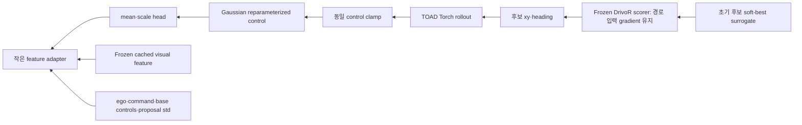

# 잔차 제어 탐색 분포 연구 타당성 검토

조사·검토일: **2026-10-11**. 공개 자료 마감일도 동일하다. 저장소 시작 상태: `junseong/main`, `c73f966`, 작업 트리 깨끗함. 이번 산출물은 **조사와 gradient 진단**이며, optimizer step·새 성능 비교·새 학습 대기열은 없다. 기존 LPWM 학습은 유지했다.

## 1. 결론

| 항목 | 판단 | 근거 |
|---|---|---|
| Novelty | **현재 형태로는 부족** | FlowPlan의 frozen perception→scene-conditioned sampler→미분 가능한 BM/cost, POPLIN의 policy 초기화+Gaussian residual CEM, TOAD의 기존 제어 탐색과 실질적 중복 |
| 기술적 가능성 | **현재 환경에서 가능** | 실제 local DrivoR checkpoint·Drive-JEPA feature cache로 score→경로→제어→sampler gradient 검사 통과. 기본 forward의 detach는 별도 scorer 호출에서 생략해야 함 |
| 적은 GPU로 첫 연구를 할 가치 | **작은 정보가치 검증에 한해 조건부 가치** | 59,168개/159,008개 규모의 sampler로 검증 가능. 다만 기존 scorer의 큰 selection regret 때문에 좋은 분포를 만들어도 채점 단계에서 이득이 사라질 위험 |
| 지금 진행 여부 | **본 학습 보류** | 다음 작업은 frozen scorer가 native proposal 및 작은 residual 후보를 제대로 순위 매기는지 확인하는 것. 이것을 통과한 뒤에만 작은 A/B/C 비교를 고려 |

추천 질문 하나: **“base 경로와 후보의 제어 분산으로 설명되지 않는 시각 정보가, 같은 최종 탐색 예산에서 실제 좋은 후보의 발견 확률을 높이는가?”**

추천 방법 하나: backbone/base/scorer를 고정하고, **유계 diagonal Gaussian 초기 평균·scale**만 학습한다. 첫 학습 목적은 **공식 평가로 확인한 좋은 후보의 offline distribution fitting**을 권한다. conditional attention adapter는 visual pooling의 추가 이득을 확인한 뒤 검토한다.

이는 원래 연구의 ‘planning에 필요한 정보를 현재 시각 표현에서 읽어낼 수 있는가’라는 하위 질문이다. entity별 미래를 예측하거나 정보의 양을 선택하는 모델은 아니므로, 이 실험으로 원래 전체 연구 목표를 달성했다고 주장할 수 없다.

## 2. 가까운 선행연구와 가장 강한 반박

11개 방법의 날짜·관측·분포·학습 모듈·gradient·추론 탐색 비교는 [literature_comparison.md](literature_comparison.md), [CSV](literature_comparison.csv)에 있다. 검색어와 확인 URL은 [search_log.json](search_log.json)이다. abstract만으로 동등성을 판단하지 않았다.

### 가장 가까운 5개

1. **FlowPlan**: §IV와 부록을 읽었다. 실제 conditioning은 pretrained LiDAR/map perception feature와 ego history다. perception/prediction 및 pretrained control cVAE는 고정하고, conditional NAF sampler를 학습한다. 학습은 planner cost의 Boltzmann 분포에 대한 reverse KL이며, samples→frozen decoder→differentiable BM/cost→flow로 역전파한다. 추가 예산에서 CEM refinement도 실험했다. 따라서 ‘고정된 시각/scene feature로 작은 sampling policy를 학습하고 고정 cost로 평가’하는 큰 구조는 새롭지 않다. 제안의 차이는 raw-camera cache, base 주변 Gaussian, neural scorer, 초기 분포만 수정하는 제약이다. [원문 §IV·부록](https://arxiv.org/pdf/2007.16162)
2. **POPLIN-A-Init**: policy가 제어 시퀀스의 중심을 제안하고 Gaussian noise를 더해 CEM을 시작한다. 정책 학습은 CEM 계획의 distillation을 포함한다. 단순 학습 초기화가 기존 action-space CEM보다 항상 좋았다는 근거로 읽으면 안 된다. 제안은 시각 조건부 residual mean/scale과 frozen neural scorer 학습으로 다르지만, ‘learned initial control distribution’ 자체의 기여는 겹친다. [원문 §4](https://arxiv.org/html/1906.08649), [공식 설정](https://github.com/WilsonWangTHU/POPLIN)
3. **Learning Sampling Distributions for MPC**: context-conditioned flow와 latent shift를 학습하고, online MPPI/DMD 업데이트와 warm start까지 latent에서 수행한다. Eq. 8–14는 bilevel 학습과 likelihood-ratio gradient를 다룬다. 제안은 full controller를 학습하지 않아 가볍지만, 이후 CEM 결과에 대한 credit assignment도 제공하지 않는다. [원문 §3](https://arxiv.org/html/2212.02587), [CoRL 원문](https://proceedings.mlr.press/v205/sacks23a.html)
4. **DCEM**: differentiable elite weighting을 통해 CEM update 자체로 역전파한다. 공식 코드의 `Normal.rsample`, LML/softmax, mean/std update를 확인했다. 제안에서 reparameterization은 초기 후보의 연속 gradient만 제공한다. hard top-K/argmax의 선택 변화나 원본 TOAD의 `no_grad` CEM까지 미분 가능해지지 않는다. [ICML 원문](https://proceedings.mlr.press/v119/amos20a.html), [공식 함수](https://github.com/facebookresearch/dcem/blob/main/dcem/dcem.py)
5. **TOAD**: frozen base proposals를 가속도·yaw rate로 변환하고, selected proposal을 초기 평균으로, proposal 제어 spread를 초기 표준편차로 사용한다. scorer·anchor·comfort에 따라 hard elite CEM을 수행한다. 제안은 이 초기 mean/scale을 학습하는 확장이다. 특히 원문은 vocabulary 밖 scorer 신뢰성의 문제를 다룬다. 초기 학습 분포의 neural score가 높아져도 실제 PDMS가 좋아진다고 연결할 수 없다. [원문](https://arxiv.org/html/2606.07170), [공식 코드](https://github.com/valeoai/TOAD)

### 현재 제안에 제기될 novelty 반박

- **“FlowPlan을 대각 Gaussian으로 단순화하고 TOAD 앞에 붙인 것이다.”** frozen perception, learned conditional sampler, differentiable dynamics/cost의 조합은 이미 있다.
- **“POPLIN의 learned CEM initialization을 주행 모델에 적용한 것이다.”** residual control mean과 scale을 학습한다는 것만으로 새로운 탐색 원리를 제시하지 않는다.
- **“이미 영상을 사용하는 planner 옆에 또 conditional trajectory generator를 붙였다.”** 시각 입력이 기존 경로·proposal spread에 없는 정보를 제공했다는 B/C 비교가 필요하다.
- **“Adapter는 표준 attention/pooling 또는 추가 MLP 용량이다.”** token adapter만으로 상황별 정보 선택이라는 기여가 생기지 않는다. pooled visual baseline과 matched-capacity 비교가 필요하다.
- **“freeze/cache/reparameterization은 알려진 구현 선택이다.”** 낮은 학습 비용은 실행상의 장점이다. 성능·동일 시간 예산·정보의 추가 가치가 함께 확인될 때 연구 결과가 된다.

### 최소 변경 대안 하나

가제보다 검증 질문을 좁힌다: **“시각 정보가 기존 proposal uncertainty를 넘어, 적은 후보 예산에서 탐색 분산의 방향과 크기를 보정하는가?”** 먼저 mean을 고정하고 scale만 학습하는 조건으로 해석을 단순화하는 대안이 있다. 별도 모듈은 필요 없다. 이것도 그 자체로 새로운 방법은 아니며, 같은 모델·scorer·시간 예산에서 pooled visual의 추가 가치를 입증해야 한다. mean+scale 첫 비교가 성공한 뒤 추가 capacity 없이 mean-only/scale-only 기능적 분해로 검증할 수 있다.

## 3. 실제 코드·자산 감사

### Base/scorer 선택

**현재 실행 가능한 조합**은 기존 축소 실험의 `CommonPlannerModel('drivor')`와 같은 checkpoint의 scorer다.

- checkpoint: `outputs/four_model_small_corpus_v1/drivor/pass5.pt`, **3,200 update**. SHA는 [diagnostics.json](diagnostics.json)에 기록했다.
- 이는 local front-history DINOv2-S 적응 모델이다. 원래 DrivoR의 4카메라 설정이나 논문에 보고된 TOAD scorer 재현으로 부르지 않는다.
- base forward: `src/planning_aware_future_prediction/object_centric/small_corpus_models.py::CommonPlannerModel`, 최종 proposals **64×8×3**, 선택 경로 **8×3**.
- scorer: `reference_repositories/DrivoR/navsim/agents/drivoR/drivor_model.py:177`, `pos_embed(flattened trajectory)`→scoring decoder→ego token 추가→6개 score heads. 고정 vocabulary index 조회가 아니다.
- original forward의 `proposals.reshape(...).detach()`가 경로 gradient를 막는다. 이번 wrapper는 **같은 weight와 score 계산을 유지하며 입력 detach만 생략**했다. reference 파일은 수정하지 않았다.
- weight freeze는 `requires_grad_(False)`+`eval()`이다. sampler 학습용 scorer forward에 `no_grad()`를 사용하면 안 된다. 이미지 cache 생성에만 `no_grad()`를 썼다.

**새로 확인한 중요한 제약**: scorer의 `Block`에는 candidate self-attention이 있다. 따라서 점수는 `J(trajectory, entire candidate set, scene, ego)`다. arbitrary candidate 수를 받을 수 있지만 점수가 후보별 독립 함수는 아니다. 후보 수·동료 경로·최종 fallback 평가 context를 통제해야 한다. soft-best gradient도 한 경로를 바꿨을 때 다른 경로의 score가 달라지는 교차 항을 포함한다.

공식 TOAD를 `reference_repositories/TOAD`에 clone했다. commit `cfa88e008080d0799b2859b5935c257048ec0adf`, commit date **2026-09-11**, 조사일 이전이다. `drivor_cem_portable`의 helper를 직접 사용했다. prescribed `checkpoints/epoch_29_54.6.ckpt` 경로는 현재 없다. 이는 해당 로컬 경로의 부재이며 공개 weights 자체가 없다는 주장이 아니다. 원논문 수준의 scorer로 확장하려면 정확한 checkpoint와 해당 입력/config를 별도로 확보·검증해야 한다.

### Drive-JEPA 분기와 캐시

| 항목 | 실제 확인 |
|---|---|
| 기존 encoder feature | `outputs/soft_token_reweighting_v1/cache/visual_tokens.npy`: **11,000×128×1024 FP32**, mmap 가능; RGB cache 아님 |
| 추출 위치 | perception-free image encoder의 512×1024 출력→원래 2×2 pooling→128×1024, **learned image_fc 전** |
| 입력 | 전방 1대, 과거·현재 2frame, 약 −0.5s/0s, 512×256; 위아래 28px crop, INTER_LINEAR, /255, ImageNet normalization |
| token 정보 | 8×16 grid, camera 0, 두 관측 frame의 joint tubelet; patch token을 개별 시점/객체로 해석하지 않음 |
| mask·ID | valid mask·ego·GT trajectory·recording/log·split·row metadata 있음. 이번 2장면에서 ego 재배열·GT exact match, 입력 timestamp ≤0 검사 통과 |
| 기존 검증 | 이전 cache 생성 기록의 raw/cache encoder 차이 0, prediction 최대 차이 약 1.91e−6. 이번에는 대형 ViT encoder를 다시 실행하지 않음 |
| scorer 호환성 | Drive-JEPA의 128×1024와 DrivoR의 16×256은 **서로 다른 표현**. 크기를 맞추는 projection으로 checkpoint 호환성이 생기지 않음 |
| PF base | perception-free는 단일 경로 planner이며 이 분기에 trajectory scorer가 없음. 단일 base만 쓰면 TOAD proposal spread를 제공하지 않아 std floor 또는 다른 공통 기준이 필요 |
| proposal-centric 분기 | `drive_jepa_perception_based/score_module/scorer.py:48`: score는 생성 과정의 `bev_feature`를 pooling해서 읽음. proposals 좌표를 자유로운 score 입력으로 사용하지 않음. 경로만 바꿔 같은 latent를 유지하면 유효한 arbitrary-path 평가가 아님 |

이번 실제 진단은 Drive-JEPA token을 **adapter 입력으로만 재사용**하고, 같은 sample ID의 2frame RGB에서 **별도의 DrivoR register feature**를 추출했다. scorer memory는 image backbone의 temporal fusion 후 **16×256 FP32**이며 ego token도 캐싱했다. cache 생성에 backbone 호출 1회, 캐시 gradient 진단에서는 호출 0회다.

로컬 scorer cache: `outputs/residual_control_sampler_feasibility_20261011/actual_scorer_cache.npz`; metadata와 sample manifest도 같은 폴더에 있다. 공개 가능한 작은 metadata 사본은 [actual_scorer_cache_metadata.json](actual_scorer_cache_metadata.json)이다.

**후속 첫 실험은 같은 DrivoR register를 sampler에도 사용하는 편이 낫다.** 이렇게 하면 별도 Drive-JEPA feature의 추가 관측 계산/백본 차이가 없다. register는 이미지 위치와 직접 대응하지 않으므로 spatial heatmap 대신 token/조건 변화 그래프로 해석한다. 기존 Drive-JEPA cache 재사용 조합은 기술적 가능성을 확인한 것이며, 최소 비용·최소 confound 조합으로 확정한 것은 아니다.

### 제어·경로·공식 evaluator

- TOAD `cem_utils.py::proposals_to_controls`, `bicycle_rollout`, `clamp_controls`, `direct_comfort_cost`를 수정 없이 사용했다. 연속 Torch 연산이며 BM helper 자체에 no_grad는 없다.
- 8개 제어 step, dt 0.5s, ego-local `(x,y,heading)` 경로. 제어는 `(acceleration, yaw rate)`이며 steering angle과 혼동하지 않는다. `BM`이라는 명칭 아래의 실제 공식 helper는 midpoint speed/heading 적분이다.
- `sigma_TOAD=max(0.5*std(proposal_controls), [0.1,0.025])`, population std. proposed mean correction ±1 reference std, scale 0.5–2는 **잠정 trust-region bounds**이며 최적 범위로 검증한 값이 아니다.
- 원본 `cem_optimize`에서는 `init_traj`가 초기 mean과 anchor penalty 기준을 동시에 정한다. 후속 구현은 **learned initial mean/std와 원래 base anchor를 분리하는 입력**이 필요하다. learned mean을 `init_traj`로 전달하면 anchor까지 바꾸므로 초기 분포만 학습한 통제가 아니다. 이번은 초기 sample/gradient 진단이며 learned initializer를 full CEM에 통합한 코드는 아직 없다. 후속 hard elite/update 식은 그대로 두고 initializer 입력만 분리해야 한다.
- 여기의 learned scale 범위는 첫 draw의 표준편차 비율이다. reference floor를 적용한 sigma에0.5를 곱하면 첫 draw는 원래 floor 아래일 수 있다. 후속 CEM update의 원래 floor는 유지한다. 첫 draw에도 같은 floor를 재적용하는 조건과 혼동하지 않으며, 그 조건은 별도 protocol로 정의해야 한다.
- 공식 control clamp는 가속도 **[−6.075, 3.6]m/s²**, yaw rate **[−1.425, 1.425]rad/s**이다. comfort 한계보다 1.5배 넓어 control clamp 통과가 comfort 통과를 의미하지 않는다.
- `speed.clamp_min(0)`와 control clip의 포화 구간은 gradient가 0이다. inverse conversion의 zero displacement sqrt는 입력 미분 시 주의해야 하므로 base inversion은 고정/cached 상수로 둔다.
- 저속에서 yaw rate와 속도의 bicycle steering 관계를 별도로 제한하지 않는다. 코드상 speed가 0이어도 heading 적분은 계속될 수 있어 실차의 제자리 회전이 불가능하다는 제약을 자동 보장하지 않는다. 이는 코드에서 확인한 모델 한계이며, 이번 두 장면에는 zero-speed sample이 없어 실제 정지 장면의 영향을 측정하지 않았다.
- inverse helper가 이동 거리로 구하는 속도와 midpoint forward BM의 속도 정의가 달라, 일반적인 planner 경로가 round trip에서 정확히 보존되지 않는다. 이번 실제 2장면 ADE **0.34076/0.33820m**. **sampler OFF=원래 TOAD 초기 분포 복원**이지 **원래 base 경로 exact 복원**은 아니다. 최종 original base fallback을 유지하고 따로 비교해야 한다.
- 현재 정상 평가 경로는 **NAVSIM v1 PDMS**: `scripts/score_lpwm_drivor_navtest.py::score_scene`→`navsim.evaluate.pdm_score.pdm_score`→40×0.1s simulator/scorer. GT/map/actor metric cache를 사용하는 NumPy/geometry 평가이므로 sampler의 differentiable loss가 아니다.
- EPDMS는 NAVSIM v2 전용 평가·데이터·checkpoint/config가 맞아야 한다. 이번 감사에서 v2 평가 자산과 호환성은 검증하지 않았으며, 현재 v1 PDMS를 EPDMS로 부르지 않는다.

### 실제 gradient 경로



그림 화살표는 gradient 역방향이다. backbone/base/scorer weight는 업데이트하지 않는다. CEM hard elite 선택·argmax 및 공식 PDMS는 이 graph에 포함하지 않는다.

## 4. 실행한 최소 진단

코드: [sampler와 frozen scorer wrapper](../../src/planning_aware_future_prediction/models/residual_control_sampler.py), [CPU 진단](../../scripts/diagnose_residual_control_sampler.py). 측정 원본: [diagnostics.json](diagnostics.json).

| 검사 | 합성 / 실제 | 결과 |
|---|---|---|
| 같은 epsilon, 보정 0 vs 원래 TOAD 첫 샘플 | 둘 다 | raw control·rollout 최대 오차 **0**; 원본 `cem_optimize` trace와 비교 |
| finite controls·trajectory·score·gradient | 실제 2scene×8candidate | 통과 |
| scorer만 통한 sampler gradient | 실제, untrained nonidentity probe | adapter **5.98e−4**, mean **1.049e−2**, scale **9.925e−3** norm; 모두 finite/nonzero |
| finite difference | 실제 frozen scorer, FP64 | 3방향×2 step size, **6/6 통과**, 최대 상대 오차 약 **5.15e−8** |
| original forward score vs cached scorer | 실제 64개 원래 proposal | 최대 오차 **0** |
| frozen 모델 gradients·weight update | 실제 | base/encoder/scorer parameter grad 없음; 전체 tensor digest 불변; sampler도 optimizer update 없음 |
| cached 단계 backbone 호출 | 실제 | **0회**; 별도의 작은 cache 생성에는 1회 |
| sampler OFF 복원 | 합성 | 같은 epsilon에서 TOAD 초기 controls exact 복원 |
| visual input 교체 | 실제, 학습하지 않은 작은 nonzero heads | 동일 ego/base/epsilon에서 mean·scale·후보가 변함. xy 평균 변화 **0.128mm**로 매우 작음 |
| candidate-set 의존성 | 실제 | 같은 첫 경로를 혼자/8개와 평가한 log score 최대 차이 **0.01551** |
| control/comfort | 실제 16candidate | clipped fraction 0, zero-speed fraction 0; comfort 위반 **1/16** |

**초기화 주의**: exact identity를 위해 두 출력 head weight/bias를 모두 0으로 두면 첫 backward에서 adapter gradient는 0이다. head gradient는 mean 0.07669/scale 0.01565로 유한·양수였다. 이것은 전체 경로가 영구적으로 막힌 것이 아니라 zero head의 chain rule 때문이다. 학습하지 않은 별도 작은 nonzero weight probe(std 0.001)에서는 모든 module gradient가 통과했다. 이 probe를 ‘학습 후 checkpoint’라고 부르지 않는다. 실제 후속 학습은 exact zero heads로 시작하고 첫 head update 후 adapter gradient를 검사하거나, 첫 분포 오차를 허용하는 작은 초기화 중 하나를 **사전에** 선택해야 한다.

**이 진단이 보여주지 않는 것**: visual usefulness, 학습 가능 곡선, 최종 CEM 개선, reward gradient의 안전성, 실제 PDMS 개선. visual 교체는 기능적 연결 확인이며 영상과 ego가 불일치하므로 인과적 성능 주장에 쓰지 않는다. 이번 새 PDMS/EPDMS 측정은 없다.

### 실제 비용

- CPU 2 threads, PyTorch 2.8/Python 3.12, CUDA_VISIBLE_DEVICES 빈 값. **누적 GPU 사용 0초**, optimizer step 0. 본 진단 재실행들도 CPU였다.
- 실제 2장면 cache 생성 약 **7초**, 진단 actual section 약 **8.5초**, 프로세스 최대 RSS 약 **1.18GB**. 반복별 실제 시간은 JSON에 있다.
- 작은 module: Drive-JEPA pooled input **159,008개**; DrivoR pooled input **59,168개**. encoder/scorer trainable parameter 0.
- 최종 CPU profile, 2장면당 후보 8/16/32: scorer forward+input backward 약 **30/25/35ms**. 각 1회 측정이므로 단조 속도 곡선이나 GPU 속도로 일반화하지 않는다.
- save-for-backward tensor 크기 합은 약 **53/88/158MB**. frozen weights 저장을 포함하며 peak memory도 GPU allocation도 아니다. 작은 trainable parameter 수만으로 낮은 역전파 비용을 주장하지 않는다.
- 실제 범위: 가속도 −1.805~1.939m/s², yaw rate −0.150~0.313rad/s. comfort cost는 공식 6개 threshold의 squared excess이며 collision/offroad 검사와 다르다.
- 현재 cache에는 past yaw rate가 없어 comfort의 경계 yaw rate를 0으로 가정했다. 이후 실험에는 원본 관측 ego history로 이를 복원해야 한다. 이번 1/16은 이 제한 아래의 helper 진단이다.

### 기존 결과가 제기하는 경고

별도 과거 192장면 balanced-command 진단에서 같은 아키텍처의 local DrivoR는 selected PDMS **72.76099**, candidate oracle best **97.80808**, regret **25.04709점**이었다. [원본 참조와 요약](repository_evidence.json). 이는 **기존 후보 평가 로그 재검토**이며 이번 sampler의 성능 측정이 아니다. 전체 NAVTEST나 다른 1,024장면 점수로 바꿔 말하지 않는다.

**2026-10-11 후속 감사 정정:** 해당192장면 분석은 `pass3.pt`의 **1,920update**에서 생성됐다(`scripts/diagnose_small_corpus_planner.py::load_model` 및 당시 `inference_complete.json`). 이번 gradient 진단에 사용한 `pass5.pt`의3,200update와 동일 checkpoint가 아니다. 과거수치·로그는 보존하며, pass5 scorer의 품질은 [새64장면 calibration](../frozen_drivor_scorer_calibration_20261011/report.md)에서 별도로 측정한다. 과거192장면의기준미충족을pass5의실측결과로귀속하지 않는다.

확인 사실은 이미 좋은 후보가 있었는데 선택에서 상당한 손실이 났다는 것이다. 추정은 현재 frozen scorer를 gradient reward로 더 강하게 최적화하면 그 오평가를 이용할 가능성이 있다는 것이다. residual 밖 후보에 대한 정확도와 gradient 방향의 실제 안전성은 **미확인**이다.

## 5. 학습 목적·실패 가능성

### 목적 선택

| 목적 | 장점 | 핵심 한계 | 첫 실험 적합성 |
|---|---|---|---|
| GT trajectory imitation | 라벨·기존 loss 이용 쉬움, scorer 역전파 없음 | 장면당 단일 정답, 분산 추정 불명확; 좋은 탐색 분포와 다른 목표 | sanity baseline 정도 |
| **Offline good-candidate fitting** | 좋은 candidate controls와 likelihood만으로 작은 module 학습; scorer activation backward 제거; teacher label 감사 가능 | teacher search·공식 평가 비용, teacher support 한계, 혼합 mode를 단일 Gaussian으로 fitting 시 평균이 나빠질 수 있음 | **현재 권고** |
| Frozen scorer reparameterized learning | 추가 GT 없이 직접 연속 reward gradient 활용 가능; 이번 연결 검사 통과 | reward hacking, candidate context 의존, 최종 hard CEM 목표와 불일치; 현재 scorer regret 큼 | scorer 품질 검증 뒤의 후속 조건 |

offline fitting에서는 teacher가 실제 생성한 **raw/control samples·clipped controls·공식 score**를 함께 보관한다. GT 경로를 inverse BM으로 바꾼 결과를 정확한 teacher controls로 간주하지 않는다. 좋은 후보에 가중한 Gaussian NLL로 초기 residual mean/scale을 학습한다. teacher 분포의 unimodal 적합도가 낮으면 큰 generative model을 추가하지 말고 현재 diagonal Gaussian 가설을 보류한다. pseudo-label은 planning simulator/GT에 의존하므로 ‘무감독 라벨 불필요’로 부르지 않는다.

### Soft-best와 KL

주어진 surrogate는 안정화하면 다음과 같다. 이번에는 gradient 진단용으로만 계산했으며 최종 학습 목표로 확정하지 않았다.

```text
utility_m = learned_log_score_m - 0.5*anchor_control_cost_m - 0.05*comfort_cost_m
soft_best = alpha * [logsumexp(utility_m/alpha) - log(M)]
loss = -mean_scene(soft_best) + lambda*mean_scene(KL_preclip)
KL_preclip = 0.5*sum_time,control(exp(2*log_scale)+delta_mu^2-1-2*log_scale)
```

- 평균 utility는 대부분의 후보를 좋게 만들려 한다. hard best는 한 후보의 성능을 보지만 최대값의 winner switch가 smooth하지 않다. soft-best는 utility softmax로 좋은 후보 쪽 gradient를 크게 준다.
- `max(J)-alpha*log(M) ≤ soft_best ≤ max(J)`. alpha→0이면 sampled hard best, 큰 alpha에서는 mean utility에 가까워진다. 이 사실은 **실제 PDMS의 기대 best-of-M**이나 **최종 CEM 출력**을 최적화한다는 뜻이 아니다.
- 작은 alpha·한 번의 epsilon draw는 운 좋은 outlier를 강화할 수 있다. 독립 epsilon 평가와 최종 출력 검사가 필요하다. M을 바꾸면 목적의 통계적 의미도 달라진다.
- KL은 표준정규 VAE prior가 아니라 **TOAD 초기 Gaussian과 learned Gaussian 사이의 preclip KL**이다. clipping·BM 이후 분포의 Gaussian KL로 해석하지 않는다. 양쪽에 같은 deterministic transform을 적용하면 data processing에 의한 upper bound는 있지만, 비가역 transform 이후 KL을 직접 측정한 값은 아니다.
- mean bounds·scale bounds·KL은 locality를 제한할 뿐, 안전이나 scorer validity를 보장하지 않는다. 정확한 alpha/lambda를 이번 결과로 튜닝하지 않았다.

### 실패 위험과 현재 근거

| 위험 | 현재 판정·후속 확인 |
|---|---|
| variance collapse·diversity 손실 | 미검증. scale floor를 유지하고 실제 clipped control/경로 분산·effective distinct candidate 수 기록 |
| 큰 분산/outlier로 score 상승 | 미검증. scale upper bound·tail score vs 공식 score·comfort 위반·sample clipping fraction 함께 검사 |
| scorer reward hacking·proposal 밖 일반화 | **우선 위험**. 과거 in-proposal selection regret 큼; 현재 input gradient가 맞다는 검사는 reward 품질 검사가 아님 |
| 단일 Gaussian의 mode 한계 | left/right, yield/proceed 등의 분리된 support를 평균이 표현하지 못할 수 있음. 시각 조건이 mode를 선택해도 같은 장면의 대안을 모두 표현하지 못함 |
| 시간별 독립 noise·jerk | 실제 1/16 comfort violation. 최초는 TOAD 원본 noise를 유지해 통제; smooth basis는 별도 가설로 나중에만 검토 |
| visual 입력 무시 | 지금 probe의 영향 0.128mm. **학습된 효과 아님**. 이후 sampler OFF·visual constant·ego/기반 경로 고정 입력 교체·gradient별 분석 필요 |
| adapter 용량과 조건 효과 혼동 | B/C 동일 module·parameter 수, B visual constant. D는 pooled C뿐 아니라 활성 MLP capacity를 맞춘 control 필요 |
| 초기 분포만 변하고 CEM 결과 동일 | 미검증. 첫 후보와 final CEM을 모두 평가; final 이득이 없으면 reduced-budget 결과와 full-budget 결과를 구분 |
| frozen scorer의 activation 비용 | 실제 saved-tensor 규모가 후보 수에 따라 증가. candidate self-attention은 M² 항도 있음. GPU profile 전 전체 학습 시간 단정 금지 |
| base 경로/BM 불일치 | 실제 약 0.34m roundtrip 변형. 모든 A/B/C는 같은 BM·clamp, original base fallback을 공통 유지 |
| candidate context에 따른 점수 변화 | 실제 0.01551 log-score 차이. 후보 집합·chunk size·fallback 호출 문맥을 고정하고 singleton score와 mixture score를 섞지 않음 |

## 6. 가장 작은 후속 설계 — 미실행

기계적 gradient gate는 통과했지만 **scorer quality gate는 아직 통과하지 않았다**. 다음 JSON은 준비된 설계이며 실행 queue/config가 아니다: [followup_protocol.json](followup_protocol.json).

### 먼저 확인할 것 하나: scorer calibration

고정 개발 recording에서 64장면을 사전 선택한다. native proposals와 작은 TOAD residual 후보를 같은 후보 집합 크기로 평가하고, 공식 PDMS와 neural score의 scene별 ranking·top selection regret·unsafe false-positive를 비교한다. stationary와 turn도 포함하되 임의로 객체/교차로 라벨을 만들지 않는다. neural input gradient의 작은 이동 전후 공식 PDMS도 별도로 검사한다. 이 부분은 미분 불가능하며 finite difference 정합성과 다른 검사다.

이를 위한 정확한 추가 자산은 **새 scorer checkpoint** 또는 **현재 scorer가 residual candidate에서 믿을 만하다는 개발셋 calibration 결과**다. 공개 TOAD weights로 바꾸면 그 모델의 원래 camera/preprocessing/register cache를 사용하고 모든 A/B/C를 새 공통 조건에서 비교한다. 이전 축소 모델 점수를 baseline으로 대체하지 않는다.

### Gate 이후 A/B/C

| 조건 | 초기 분포 | 정보 |
|---|---|---|
| A | 원래 TOAD mean/std | 기존 base proposal와 control spread |
| B | learned residual mean/scale | ego·command·base controls·TOAD std + **constant visual input** |
| C | B와 같은 module | 실제 valid token mean pooling visual + B의 정보 |

- base/scorer는 같은 DrivoR checkpoint로 고정. 관측 feature도 같은 checkpoint의 16×256 scene registers를 첫 선택으로 한다. 기존 Drive-JEPA cache를 쓸 경우 별도 백본 추가 비용과 representation 차이를 명시한다.
- initializer는 mean0=`u_base+sigma_TOAD*delta_mu`, std0=`sigma_TOAD*exp(log_scale)`이고 anchor penalty는 원래 `u_base`를 유지한다. A/B/C 모두 같은 후속 CEM 함수·update floor·base fallback을 사용한다. original fallback 호출의 후보 문맥을 바꾸려면 공통 baseline도 함께 재등록해야 한다.
- B/C 구조·trainable parameter **59,168개**, 초기 tensor 동일; B도 normalization 뒤 visual input만 zero로 바꾸며 기존 planner/scorer의 visual·ego conditioning은 유지한다.
- train 2,048 official navtrain scene, dev 256 official navval scene, recording 분리; 후보 예산 **M=16, CEM K=2**, TOAD elite floor·anchor·comfort·clamp·fallback 공통. 이는 reduced-budget 설정이며 공식 TOAD 전체 설정 재현이 아니다.
- B/C optimizer/loss/step/batch/RNG common: AdamW LR1e−4, weight decay0, scheduler 없음, 최대500step, effective batch32, 공통 seed0 first pilot. A는 학습할 module이 없어 optimizer step0인 고정 기준이다. exact zero heads로 시작하고 첫 head update 이후 adapter gradient를 확인한다. curriculum·새 feature regularizer·semantic supervision·encoder fine-tune 없음. 후속 확인의 training seeds0/1/2는 사전 등록한다.
- offline teacher는 common training scenes에서만 만든다. 공식 PDMS로 확인한 elite controls를 함께 사용한다. teacher의 mean/spread가 선택한 ±1std/0.5–2scale 범위로 표현 가능한지도 학습 전에 검사한다. 대부분의 좋은 후보가 그 범위 밖이라면 loss 실패와 표현 한계를 혼동하지 않고 현재 bounded Gaussian 가설을 보류한다. teacher search와 label 평가 비용을 학습 시간에 섞지 않고 별도 집계한다.
- 2,304장면의 DrivoR scene memory FP32 약 **37.75MB**, 64개 base proposals 약 **14.16MB** + ego/GT/ID/metadata. Drive-JEPA token 추가는 약 **1.21GB**. 이는 tensor size 계산이며 새 전체 cache는 아직 생성하지 않았다.
- profiling은 warmup 후 CUDA event/wall time, synchronize, peak allocated/reserved/전체 카드 메모리로 측정한다. **base planner의 원래64proposal 생성·채점도 고정 비용에 포함**한다. M16은 추가 탐색의 후보 수이지 전체 계산의 후보 수가16이라는 뜻이 아니다. scorer calls는 base64 + scene 수×M×K + 실제 final/fallback calls를 구분해 센다. CPU teacher evaluator calls/time, cache 구축, 학습, 선택 평가, oracle candidate 평가를 각각 기록한다.
- 작은 module이더라도 frozen scorer backward를 포함하는 경우와 offline fitting을 구분해 step cost를 측정한다. GPU budget/ETA는 현재 CPU 진단으로 추정하지 않는다.

### D는 C의 가치가 확인된 뒤

D는 pooled context 대신 ego/base control-conditioned query로 valid visual tokens를 읽는다. 이 구조는 일반 cross-attention이며 ‘새로운 attention’이라고 주장하지 않는다. C/D에는 동일 활성 input projection·공통 sampling heads, 활성 trainable parameter 수를 맞춘 C의 MLP capacity control(폭 조정, 차이 1% 이내)을 둔다. 동일 parameter 수만으로 계산량/expressivity가 같다고 주장하지 않는다. ego/base 입력을 상수로 바꾼 D의 기능적 검사도 필요하다. 첫 A/B/C부터 D·mixture·flow·CEM unrolling을 늘리지 않는다.

### 평가·반증·확률성

1. **최종 선택 PDMS**와 NC/DAC/DDC/TTC/ego progress/comfort를 공통 scorer/evaluator로 측정한다. v2 자산을 확보하기 전 EPDMS를 적지 않는다.
2. 공통 candidate마다 **공식 실제 score**를 측정해 oracle best·selected·regret를 분리한다. learned neural best score를 oracle이라고 부르지 않는다. 초기 후보 집합·전체 CEM 탐색 집합·최종 출력은 구분한다.
3. 동일 M,K 비교와 **sampler overhead까지 포함한 동일 wall-time 예산** 비교를 모두 한다. A가 남는 시간으로 후보를 더 평가할 수 있다면 이 비용 통제가 필요하다.
4. OFF는 delta_mu=0, log_scale=0으로 복원하고 같은 epsilon sequence를 쓴다. 기본 분포와 후속 CEM·fallback이 일치해야 한다. OFF는 학습된 weight를 삭제하거나 base 경로와 exact equality를 요구하는 검사가 아니다.
5. command 메타데이터의 좌/직진/우/기타, 현재 speed<0.5m/s로 분해하고 각 sample 수를 보고한다. 정지 속도가 신호등 정지/교차로 GT라는 주장은 하지 않는다.
6. B/C 공통 seed 초기화·batch 순서와 **sampling RNG**를 분리한다. sampler 학습 RNG, test epsilon seed0/1/2/3/4, 연산 결정성을 따로 기록한다. B와 C는 같은 epsilon으로 paired 비교한다.
7. exact same seed 학습 재실행의 tensor digest/예측을 먼저 비교한다. 결정성이 실패하면 동일 run을 독립 sampling 반복과 혼동하지 않고 training replicate variance로 기록한다.
8. recording 단위 paired bootstrap은 고정 trained model의 데이터 변동을 다룬다. 세 training seed의 model variation과 같지 않다. seed별 차이·sampling 변동·recording bootstrap을 각각 보고하고 필요 시 nested 추정을 사용한다.
9. 기존 navval·공통 NAVTEST 1,024장면은 이미 여러 실험에 사용한 **개발셋**이다. 최종 평가는 과거 개발 recording과 독립인 NAVTEST recording manifest를 사전에 reserve하고, 방법/학습 설정을 확정한 뒤 한 번 실시한다. 전체 NAVTEST와 부분집합을 혼동하지 않는다.
10. visual shuffle은 기능적 의존성에 대한 스트레스 검사다. 불일치 영상/ego 조합의 점수 하락을 “원래 영상의 인과적 정보 가치”로 주장하지 않는다. 정보의 추가 가치 주장은 학습된 B/C의 자연 데이터 held-out 비교에 근거한다.

**반증 결과**: C가 B보다 이득이 없으면 현재 pooled visual의 추가 가치 가설을 지지하지 않는다. oracle best는 좋아졌지만 selection PDMS가 나빠지면 고정 scorer 병목이다. 초기 후보만 좋아지고 final CEM에서 같아지면 선택한 K에서 initializer 이득이 사라진 것이다. 큰 예산에서만 이득이면 제한된 예산 가설과 다르다. D만 개선해도 matched capacity control이 없으면 conditional selection의 효과로 결론 내릴 수 없다.

### 다음 학습 전에 고정할 진행/보류/중단 기준

- **진행 준비**: cache ID·timestamp·OFF·finite gradient gates 통과; native와 near-residual 평가 각각에서 oracle-vs-neural selection regret 평균 ≤5 PDMS점, 선택 후보 NC/DAC 위반률이 원 base보다 1 percentage point 넘게 악화하지 않음. 이는 기대 성능 예측이 아닌 사전 실용 gate다. 이번 과거 192장면 결과는 regret 기준을 통과하지 못한다.
- **파일럿 후 확장 후보**: C−B와 C−A의 최종 선택 PDMS 평균 차이 각각 ≥0.5점이며 paired recording CI 하한>0, NC/DAC 평균 악화가 0.2 percentage point 이내, 같은 wall-time 결과에서도 이득이 유지. 단일 pilot에서 불확실하면 “미확인”으로 두고 대규모 학습을 자동 시작하지 않는다.
- **보류**: sample 수/CI가 부족하거나 결정성 실패, scorer 후보 context가 평가마다 달라짐, 단계별 cache 불일치. 성공 기준을 결과를 본 뒤 완화하지 않는다.
- **중단/방향 변경**: B가 A와 같고 C도 B보다 개선되지 않거나, OFF와 자연 C의 선택 결과가 같거나, 실제 안전/진행을 해치면서 neural score만 높아짐. scorer가 신뢰할 만하다는 근거가 없으면 reparameterized reward learning은 실행하지 않는다.
- 조건을 바꿔 재검토하려면 새로운 protocol/version과 이유를 남긴다. 현재 파일럿은 학습 전에 정의된 설계이며 자동 실행 설정이 아니다.

## 7. 재현·산출물·미해결 항목

```bash
cd /rhome/junseong/PlanningAwareFuturePrediction
CUDA_VISIBLE_DEVICES='' OMP_NUM_THREADS=2 OPENBLAS_NUM_THREADS=2 PYTHONPATH=src \
  runtime/environments/kjs-lpwm-drivor-joint/bin/python -u \
  scripts/diagnose_residual_control_sampler.py \
  --configuration configs/residual_control_sampler/feasibility_20261011.json
CUDA_VISIBLE_DEVICES='' OMP_NUM_THREADS=2 OPENBLAS_NUM_THREADS=2 \
  runtime/environments/kjs-lpwm-drivor-joint/bin/python \
  scripts/package_residual_sampler_feasibility.py
```

합성 검사만 실행하려면 첫 명령에 `--synthetic-only`를 추가한다(같은 results 경로의 진단 JSON을 덮어쓰므로 실제 결과 보존 시 config의 결과 경로를 먼저 바꾼다). 공식 TOAD clone와 기존 환경의 의존성이 필요하며, clone 경로·commit·source hash는 JSON에 기록했다. TOAD가 없는 서버에서는 `git clone https://github.com/valeoai/TOAD.git reference_repositories/TOAD` 후 `git -C reference_repositories/TOAD checkout cfa88e008080d0799b2859b5935c257048ec0adf`로 준비한다. 실제 진단에는 지정한 local checkpoint, existing visual/RGB/ego/GT cache가 필요하다. weights와 대형 cache는 git에 들어가지 않는다. 재실행은 sampler 학습을 시작하지 않는다.

- 연구 문서: 이 파일, 선행연구 Markdown/CSV, 검색 로그, [후속 설계](followup_protocol.json).
- 실행 근거: [diagnostics.json](diagnostics.json), [repository_evidence.json](repository_evidence.json), [scorer cache metadata](actual_scorer_cache_metadata.json).
- 실제 로컬 tiny cache/manifest: `outputs/residual_control_sampler_feasibility_20261011/`.
- 남은 확인: residual 밖 scorer 품질·안전 gradient 의미, 이미지의 추가 정보 가치, CEM 이후 이득, GPU training cost, v2 EPDMS 자산, 독립 최종 recording manifest.

**판단**: 지금 단계에서 큰 학습을 시작하는 것은 권하지 않는다. 계산 그래프가 동작한다는 근거는 얻었지만, 현재 proposal의 약점보다 scorer의 오류가 먼저 보인다. 먼저 작은 scorer calibration을 끝내고, 통과하면 pooled visual A/B/C로 질문 하나만 검증하는 것이 가장 비용이 적은 다음 단계다.
